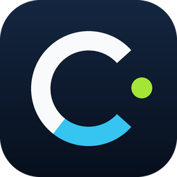
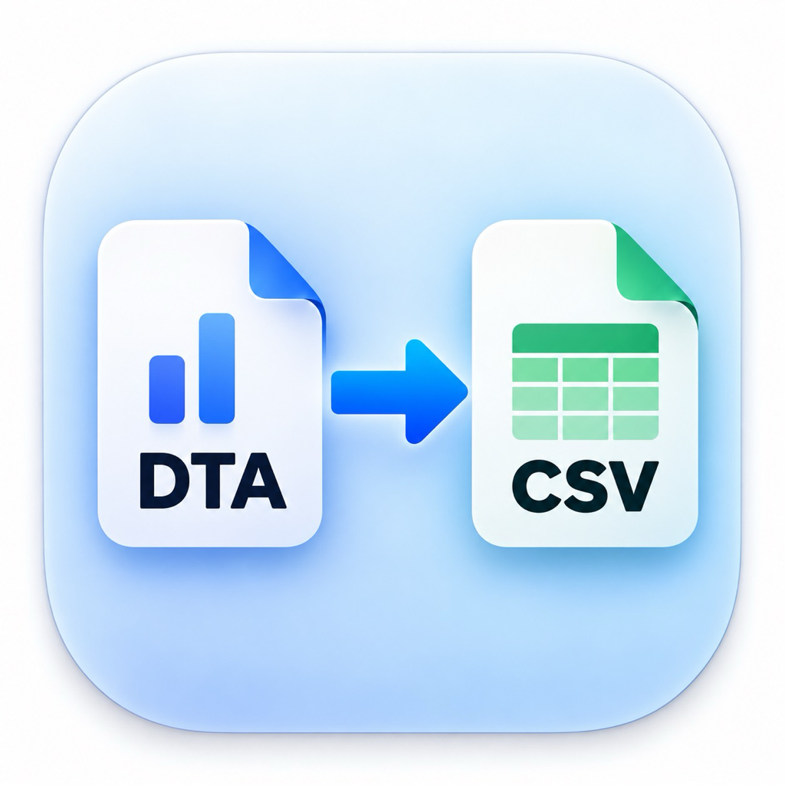

<h1>SUN WENHUAN · sunfhs</h1>

**立命馆大学信息理工学研究科修士在读，现居日本。** 
研究数字治理，也做一些自己日常用得上的小工具。

  <a href="https://dgovsys.org/members/sun-wenhuan/">实验室个人页</a> ·
  <a href="https://github.com/sunfhs?tab=repositories">全部项目</a> ·
  <a href="https://github.com/sunfhs/sunfhs/blob/main/README.md">English</a>

  
  
  

## 关于我

我从机器人与控制、手势交互一路学到数据分析。这些方向看起来不太一样，但我在意的问题有些相通：怎样让一个系统更容易理解、更方便使用。它可以是单手完成文字输入，也可以是让一本日文小说在电纸书上读得舒服一点。

学习之外，我也在日本从事租赁实务的兼职工作，接触资料核对、案件跟进和未完成事项管理。我会用 AI 和 IT 工具整理信息、记录进度，并回到原始材料确认细节。这些经历让我对流程是否清楚、结果是否可靠有了更具体的感受。

我的工具项目经常从自己的使用需求开始。我喜欢试用工具、调整细节，再看它在日常使用中是否顺手。日文阅读和电纸书带来了 YomiEpub Studio，想随时看到 Codex 额度则促成了我对 Codot 的维护与定制。

## 教育与研究

**2026–2028 年（预计）· 立命馆大学修士** 
信息理工学研究科 · [Digital Governance Systems Laboratory](https://dgovsys.org/members/sun-wenhuan/)

目前研究台湾 JOIN 平台上电子请愿的成立因素，关注请愿文本、随时间变化的公众支持，以及社会关注与请愿结果之间的关系。研究仍在进行中。

**2022–2026 年 · 立命馆大学本科** 
信息理工学部 · Information Systems Science and Engineering（ISSE）

本科阶段学习了机器人、控制、图像处理和人机交互。毕业研究围绕 RGB-D 单手手势文字输入展开：利用 MediaPipe 手部特征点和可选的 RealSense 深度信息识别动作，结合 T9 输入状态机与停留确认，探索减少误输入的方法。[代码与研究材料 →](https://github.com/sunfhs/RGBD-T9-Gesture-Input)

## 项目展示

<table>
<tr>
<td width="50%" valign="top">
  
  <h3><a href="https://github.com/sunfhs/Codot">Codot</a></h3>
  
在 Windows 任务栏或 macOS 菜单栏常驻显示 Codex 剩余额度和本地恢复时间。

  
桌面工具 · Rust / Swift

</td>
<td width="50%" valign="top">
  
  <h3><a href="https://github.com/sunfhs/YomiepubStudio">YomiEpub Studio</a></h3>
  
把日文 EPUB、TXT、HTML 转成横排、带ふりがな的 EPUB，便于在 KOReader 中阅读。

  
阅读工具 · Python / FastAPI

</td>
</tr>
<tr>
<td width="50%" valign="top">
  
  <h3><a href="https://github.com/sunfhs/DTA-CSV_mac">DTA → CSV</a></h3>
  
拖入 Stata 数据文件或文件夹，即可在 Mac 上转换为 CSV。

  
数据工具 · Swift / Python

</td>
<td width="50%" valign="top">
  <h3><a href="https://github.com/sunfhs/RGBD-T9-Gesture-Input">RGBD-T9 Gesture Input</a></h3>
  
结合手部追踪、深度信息和 T9 输入状态机，探索单手空中文字输入的研究原型。

  
本科毕业研究 · Python / MediaPipe / RealSense

</td>
</tr>
</table>

## 兴趣与工具

- **日文阅读和电纸书：**关心书籍的排版、注音，以及实际阅读时是否舒服。
- **AI 辅助工作流：**尝试用工具减少重复核对，让日常任务更容易追踪和处理。
- **语言：**在生活、工作和学习中使用中文、日语与英语。

研究和项目中涉及的技术：

  
  
  
  

